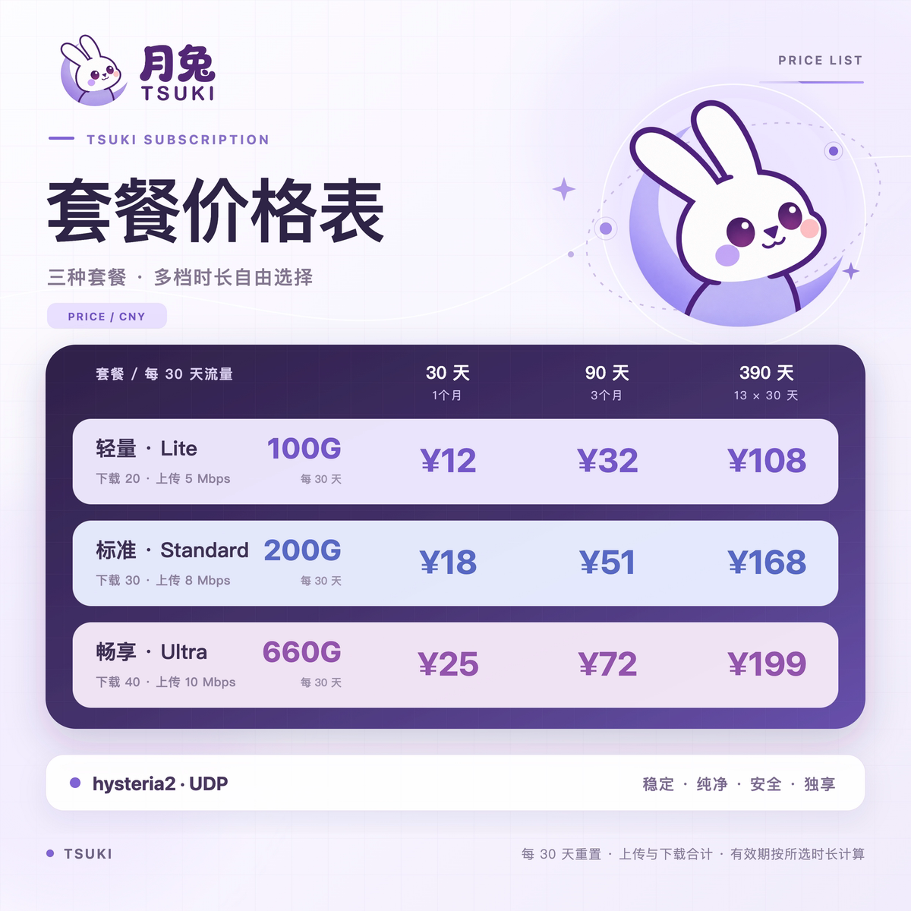

# 月兔 VPN（Tsuki）价目

官网：https://buddahs-temptation.win/tsuki

下图由品牌方于 2026-11-20 提供，不是公开网页抓取。

价格为人民币总价。流量是每 30 天的额度，每 30 天重置，上传与下载合计。390 天是 13×30 天，不是 365 天。

| 套餐 | 每 30 天流量 | 30 天总价（元） | 90 天总价（元） | 390 天总价（元） |
| --- | --- | --- | --- | --- |
| 轻量 · Lite | 100G | 12 | 32 | 108 |
| 标准 · Standard | 200G | 18 | 51 | 168 |
| 畅享 · Ultra | 660G | 25 | 72 | 199 |

规格表起价取 30 天一档的最低总价，即轻量 · Lite 的 12 元。
